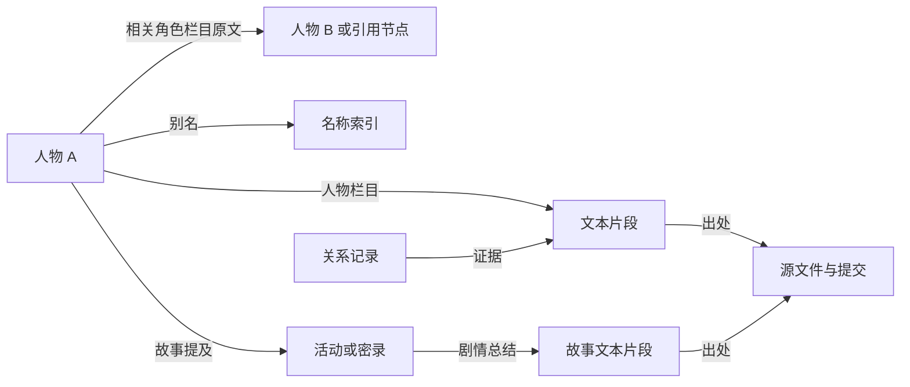

# v0.5 知识图谱说明

本版以 [littlepangding/arknights_lore_wiki](https://github.com/littlepangding/arknights_lore_wiki) 为世界观资料源，使用 SQLite 保存“实体 + 有向关系 + 可追溯文本”。这能支持人物资料卡、关系查询、局部网络展开及聊天检索，同时沿用现有本地运行环境。

## 导入范围

| 上游路径 | 导入内容 |
| --- | --- |
| `data/char_v3/*.txt` | 最新发布的人物资料；保留来源 ID、名称、别名、栏目和正文 |
| `data/stories/*.txt` | 活动剧情与干员密录总结 |
| `data/char_alias.txt` | 配套人物别名 |

所有 `prompt_*` 文件都是上游生成用提示词，不进入知识库，也不作为本终端的指令。`docs/` 是展示层副本，部分更新滞后，因此不与 `data/` 重复导入。旧版 `data/chars/` 含历史页面，不参与补全新版人物集合，避免把上游已清理的人物、异格或重复页面重新带回来。

初次迁移使用的上游提交为 `90792060a13ae653817aebeb404d2506178d1fda`。此版本的已发布集合包含 918 份人物文本和 480 份故事文本；数据库中还含未解析引用，所以实体总数不等于人物资料数。以后以本地源快照及 `stats` 的实际结果为准。

此次构建保留 910 个人物节点（其中 6 个只有名称、没有简介），480 个故事节点；5 个旧同名页面被新版替代，3 个缺少结构的生成失败页面未导入。具名但空白的页面保留为 `reference_only`，不补写档案。活动和密录按来源 ID 区分，同名故事仍分别保存。

## 来源可信度

上游 README 说明这些页面由 LLM 阅读剧情后总结，可能有错误与幻觉。导入保留二次资料属性 `llm_summary`，不会因为条目格式完整或存在明确陈述而设置为已核验原作。

| 状态 | 含义 |
| --- | --- |
| `source_asserted` | 来源明确陈述了这条信息；仍属于未核对游戏原文的二次资料 |
| `uncertain` | 来源描述含“可能”“似乎”等不确定措辞，由规则标记，仍需阅读原句 |
| `project` | 为兼容保留的项目配置状态；当前构建不再插入自创身份或人物关系 |

上游资料的 `verified` 保持为假。保留来源仓库、提交号、文件路径、文件哈希及原文位置，是为了能复查和纠错；这些字段本身不构成事实核验。上游文本中的引号和“剧情高光”也来自总结文件，不能自动当作已核对的游戏原文逐字引文。

`scope=canon` 表示条目讨论游戏世界观，`scope=fan` 表示本项目设定；`scope` 不表示可信度。来源类型、关系状态和核验标记必须一起读取。

## 数据组织

图结构存储在 SQLite 的实体表和关系表中，原始文本通过来源和片段表关联。以下是各层职责，具体数据库字段以构建器定义为准。

| 层 | 表或记录 | 保存什么 |
| --- | --- | --- |
| 节点 | `entities` | 人物、故事相关实体、未解析引用及项目设定实体的身份和摘要 |
| 名称 | `aliases` | 来源明确提供的别名及其归属，支持一名多义 |
| 出处 | `sources` | 上游仓库、提交、路径、内容哈希及来源属性 |
| 证据 | `passages` | 按栏目切分的文本及其源文件位置 |
| 人物资料 | 人物栏目与资料卡 | 简要介绍、详细介绍、剧情高光、战斗表现、相关活动等 |
| 人际关联 | `relations` | 来源人物、被提及对象、原始关系描述、出处与状态 |
| 故事关联 | `event_mentions` | 人物与故事之间的资料提及关系，独立于人际关系 |
| 导入审计 | `import_issues` | 缺字段页面、重复版本、歧义别名和无法解析的关系行 |

关键字段对应如下：

| 表 | 关键字段 |
| --- | --- |
| `entities` | `id`、`name`、`kind`、`source_key`、`summary`、`coverage`、`scope` |
| `aliases` | `alias_norm`、`alias`、`entity_id`、`origin`、`priority` |
| `sources` | `path`、`url`、`revision`、`sha256`、`generated_at`、`version`、`source_type` |
| `passages` | `ref_id`、`section`、`category`、`content`、`source_id`、`line_start`、`line_end` |
| `relations` | `src`、`dst`、`relation`、`target_label`、`description`、`passage_id`、`source_id`、`status`、`verified` |
| `event_mentions` | `event_id`、`entity_id`、`passage_id`、`basis` |
| `import_issues` | `path`、`reason`、`detail` |



人物节点保留来源 ID，不只用显示名称做主键。发布目录中同名的重复版本按文件中的生成时间选择，重复情况写入导入审计；不通过模糊名字合并人物。别名可以关联多个实体，歧义记录保留供检查。

## 人物关系的含义

只从人物文件中的“相关角色”栏目提取显式列出的关系。每条记录保留原始对象标签和完整描述，不用本地模型再次概括或打标签。

例如 A 的资料写：

```text
<相关角色>
B：曾招募 A，并在之后的行动中提供帮助。
</相关角色>
```

图中建立 `A → B`，边的描述仍是“曾招募 A，并在之后的行动中提供帮助”。箭头表示“这条关系记录来自 A 的资料、指向 B”，不能直接读成“A 招募了 B”。查询入边时同样保留原资料主人，不颠倒句意。只有另一个人物页面独立陈述了反向记录，才会多出一条相应方向的边。

当前不自动推断以下内容：

- 同场出现、同一活动中被提及，因此是朋友、同事或敌人。
- A 认识 B、B 认识 C，因此 A 认识 C。
- 一句复杂描述中的“他”“她”必然指向哪一名人物。
- “相关角色”中出现了某人，因此某人的上下级、研发或亲属关系已经完成标准化核验。

`network` 可以沿图向外展开多跳来帮助探索，但多跳路径只表示资料之间的连接，不构成新的人际关系断言。

## 未解析对象与群体

上游关系对象不总是一个独立人物名，可能是“某某及其他成员”、带斜杠的多个称呼，或者没有独立页面的人物。无法确定归属时，保留完整标签作为引用节点，保留描述和出处。

这类节点有助于发现后续需要清理的资料，但不计作已经建立完整资料卡的人物，也不应把一个群体标签拆成多个猜测的人物。后续若有明确别名或人工核对结果，可以再把引用映射到确定实体。

未解析引用的 ID 绑定资料所属人物；不同人物页面里的“父亲”“母亲”等不会合并成同一节点。这些标签也不作为独立人物别名参与对话解析，避免“多萝西的助手是谁”误命中另一份资料里的“助手”。

引用节点用 `reference_only` 标记覆盖情况；这与关系描述的 `uncertain` 状态是两个维度。一条描述可以写得很确定，但它提及的对象仍未找到独立页面。

## 故事和时间

人物与故事的关联单独存入 `event_mentions`。这种关联用于检索背景和经历，不能证明两名人物在同一场景互动，更不能直接证明关系性质。

`<time>` 是上游总结文件的生成信息。它不等于该故事的游戏内日期，也不必等于活动上线时间。当前不据此生成泰拉世界内的年代顺序；故事文本中的年代描述保持在原文里供核对。

## 项目身份与真实记忆

运行说话人固定绑定原作节点 `wiki:char_4093_frston`（Friston-3）。`lore_wiki_graph_2` 构建不再注入旧的 Friston-2 节点、二号机别名或“最喜欢可露希尔”设定。通用资料仍只从上述 Wiki 发布文件导入；小份原作人格与直接关系依据保存在 `npc_character.json`，从游戏文本镜像核对，按相关性进入当轮输入，并在 `sent_sources` 保留出处。它们没有把全部二次 Wiki 资料升级为原作核验结果。

自身原作背景和现实设备经历分开：可依据发给模型的自身原作证据用第一人称谈角色过去；这台设备的摄影结果、现实出行及会面仍只认执行记录。原作机器人不保有“保存者”完整日志和全部知识，不能把旧意识体的所有经历直接灌入当前记忆。

真实互动数据仍位于 `data/runtime/npc_memory.db`，包括明确保存的用户自述和设备执行记录。世界观知识库位于 `data/runtime/terra_lore.db`。重建世界观知识库不删除真实互动记忆，也不把历史模型回答导入为关系证据。

## 重建与检查

先关闭正在使用知识库的程序，在项目根目录执行：

```powershell
python -m friston2.knowledge.terra_kb build --source data/external/arknights_lore_wiki
python -m friston2.knowledge.terra_kb stats
python -m friston2.knowledge.terra_kb card 可露希尔
python -m friston2.knowledge.terra_kb profile 多萝西
python -m friston2.knowledge.terra_kb relations 多萝西 --limit 12
python -m friston2.knowledge.terra_kb search 矿石病 --limit 3
python -m friston2.knowledge.terra_kb network 可露希尔 --depth 1 --limit 30 --output data/runtime/closure_graph.json
```

构建在临时数据库中完成，成功后替换正式库。旧版数据库不能直接覆盖 v0.5 数据库；源数据更新后应重新构建。

检查人物关系时，先确认人物 ID 和别名解析结果，再查看描述的出处、方向及状态。若关系看似冲突，保留双方来源并回到文本核对，不能用图上的箭头替代阅读原句。

子图导出用于后续可视化或人工检查。`--depth` 控制展开层数（0—3），`--limit` 限制关系边数量（1—500）。导出包含 `roots`、`nodes`、`edges` 和 `truncated`；`truncated=true` 表示触及数量上限。局部图也受到深度限制，因此不能把没有显示的边理解为“不存在这段关系”。

## 后续可扩展内容

可以在此结构上增加关系图浏览器、人工审核界面、明确时间范围及经核验的关系类型。若要把原文描述规范化为“导师”“同僚”“亲属”等类型，应保留原描述，并增加单独的审核记录；不要覆盖当前的来源证据。

当前导入不进行联网生成，也不让本地小模型为缺失人物补写经历。资料缺失、歧义及不确定性作为数据状态保留。
